# F.I.R.E. (Fast Integrated Research Environment)

> **A local-first, AI-powered workspace that unifies scientific data ingestion, analysis, and visualization into a single conversation.**

[](https://unstop.com/hackathons/i-hack-iit-bombay-1580510)
[](https://opensource.org/licenses/MIT)
[](https://www.rust-lang.org/)
[](https://www.python.org/)

---

## The Problem

Modern scientific research is fragmented. Scientists and data analysts struggle to bridge the gap between:
1.  **Raw Data:** Scattered across complex, domain-specific formats like NetCDF (.nc) or Parquet.
2.  **Documentation:** Isolated contexts hidden in webpages and PDFs.
3.  **Analysis Tools:** Requiring specialized skills in Python, SQL, or Pandas just to get a basic visualization.

There is no single environment where you can ingest a 2GB climate dataset, crawl a documentation site for context, and simply ask: *"Plot the temperature anomalies on a 3D globe where depth > 50m based on this data."*

## The Solution: FIRE

**FIRE** acts as an intelligent, local-first IDE for your data. It combines system-level performance with agentic AI to create a secure "talk-to-your-data" environment.

Unlike cloud wrappers, FIRE runs entirely on your machine. It handles heavy scientific datasets close to the metal and uses sophisticated AI agents to plan analysis and generate dynamic 3D visualizations on the fly.

---

## Key Features

### Hybrid Rust + Python Architecture
We use the best tool for the job. A lightweight **Tauri (Rust)** shell handles blazing-fast file I/O, system security, and frontend hosting. A managed **Python sidecar (FastAPI)** handles the rich ecosystem of AI and data science libraries.

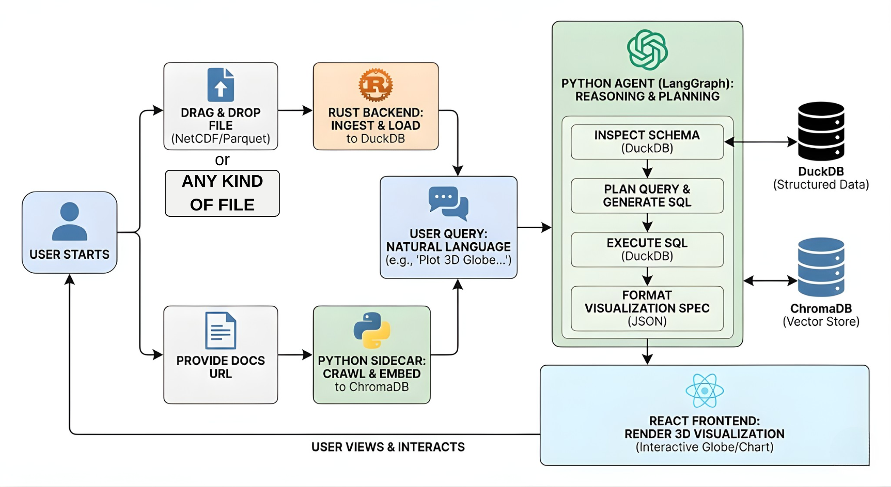

### Agentic AI Workflow (Powered by LangGraph)
This isn't just a chatbot. Our agent uses **LangGraph** to reason cyclically:
* **Schema Discovery:** Inspects DuckDB table structures before querying to prevent hallucinations.
* **Intelligent Routing:** Decides when to query structured data (SQL) vs. semantic documentation search (Vector Store).
* **Visual Planning:** Autonomously generates JSON specifications to render React-based charts and globes.

### Scientific Data Native
Out-of-the-box support for formats often ignored by standard BI tools:
* **NetCDF (.nc):** Native Rust implementations for high-performance ingestion of climate and oceanography data.
* **Parquet & Excel:** Optimized loading for structured data.

### Contextual Awareness
Integrated dynamic web crawler (using **Playwright**) to ingest external documentation URLs, chunk them, and embed them into a local **ChromaDB** vector store so the AI understands the *meaning* of your data.

### Dynamic 3D Visualization
The agent generates SQL to fetch geospatial coordinates and renders them instantly as interactive **3D Globes** (via `react-globe.gl`), scatter plots, or ECharts right in the chat interface.

### Local-First Performance
Powered by in-process **DuckDB** for analytical SQL and local **ChromaDB**, ensuring low latency and total data privacy.

---

## Technical Architecture

FIRE employs a unique hybrid architecture to balance performance and AI capability.

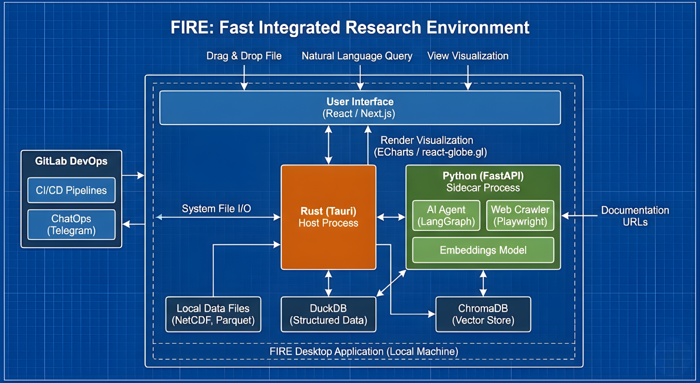

| Component | Tech Stack | Role |
| :--- | :--- | :--- |
| **Desktop Host** | Tauri v2 (Rust) | Secure runtime, file system I/O, managing sidecars. |
| **Frontend** | React, Next.js, Tailwind, Shadcn UI | User interface, ECharts/Globe visualizations, Monaco Editor. |
| **AI Sidecar** | Python (FastAPI), `uv` | Hosting the AI agent and data processing logic. |
| **Orchestration** | LangGraph, LangChain | Managing stateful, cyclic agent reasoning and tool execution. |
| **Data Engine** | DuckDB | High-performance local OLAP SQL database. |
| **Vector Store** | ChromaDB | Local embedding storage for documentation context. |
| **Ingestion** | Rust native crates & Playwright | Reading NetCDF/Parquet and crawling dynamic webpages. |

---

## GitLab DevOps Integration

Built for the GitLab Hackathon, we leveraged the full power of the GitLab platform to manage our intense development lifecycle.

### 1. Project Management (Boards & Milestones)
We used **GitLab Issue Boards** in a Kanban view to track velocity and ensure nothing fell through the cracks. Complex features like the "LangGraph Agent" were tracked using **Milestones**.

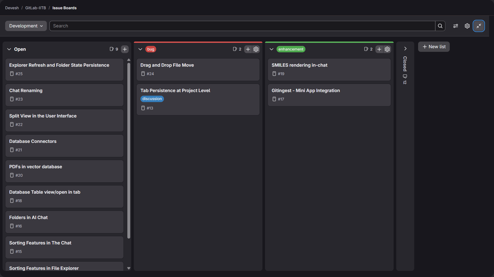

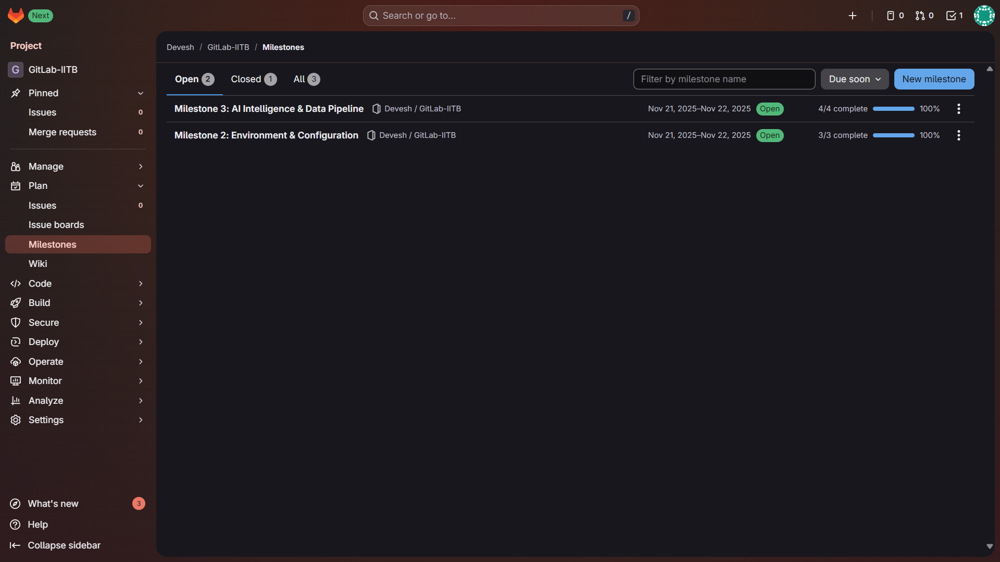

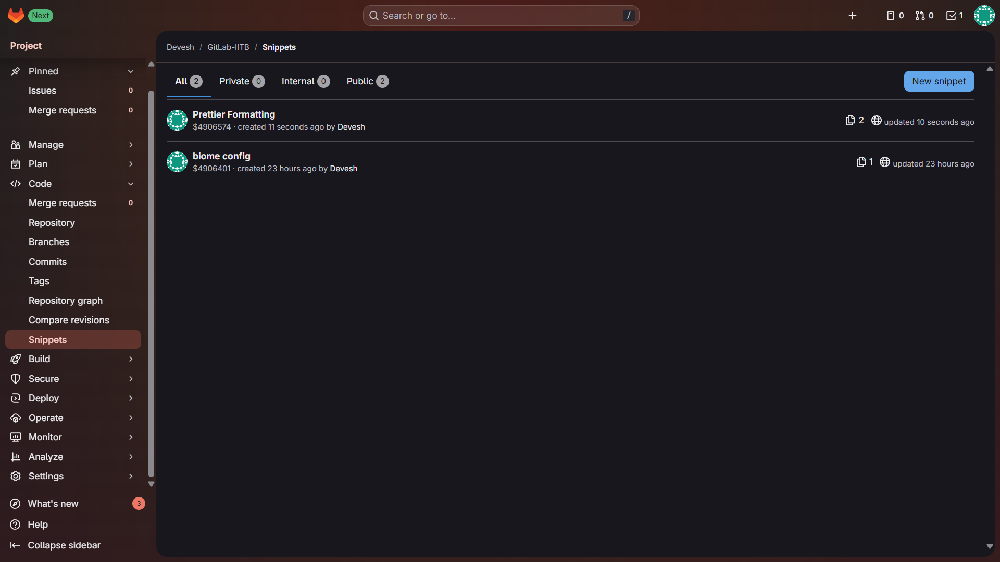

### 2. CI/CD Pipelines
Automation was key to managing our hybrid stack. Our `.gitlab-ci.yml` ensures that Rust builds don't break Python functionality and vice-versa, utilizing caching for rapid iteration.

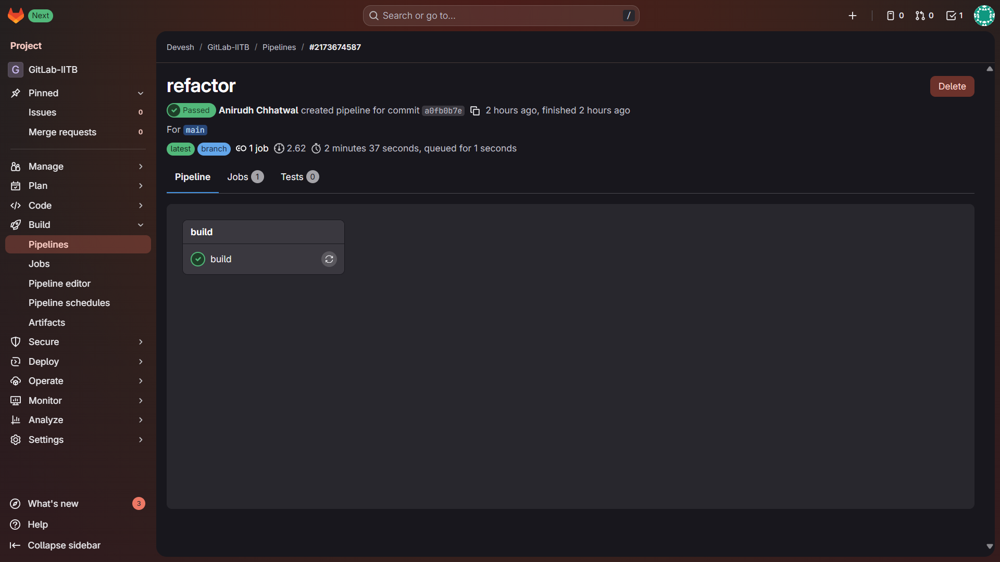

### 3. Real-Time ChatOps
We integrated **Telegram with GitLab**. Every push, merge request, and pipeline status is instantly notified to our team channel (`@gitlab_iitb`), drastically reducing communication latency during the hackathon.

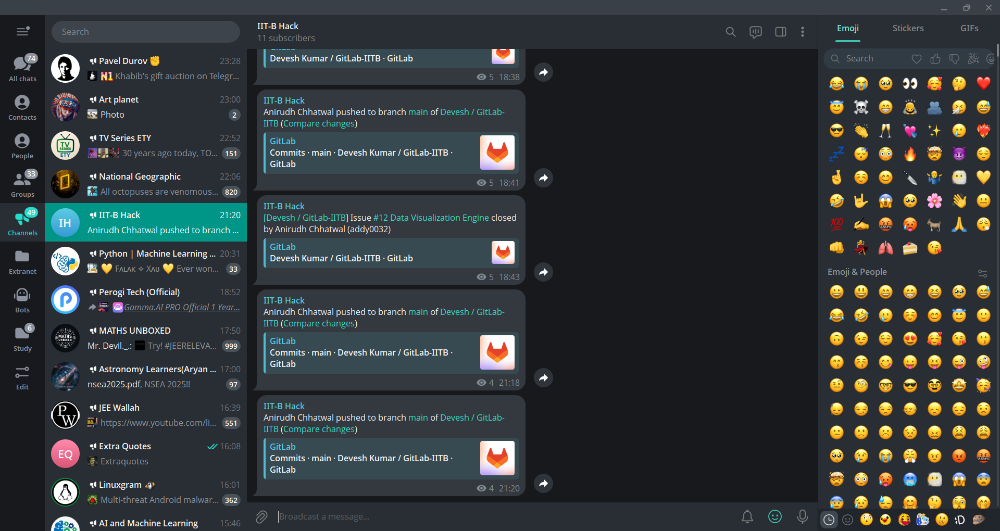

### 4. GitLab Pages
Our public-facing landing page for FIRE is hosted directly via GitLab Pages.

---

## Screenshots

### Application Interface

#### Home Screen
The main workspace where you interact with your data through natural language.

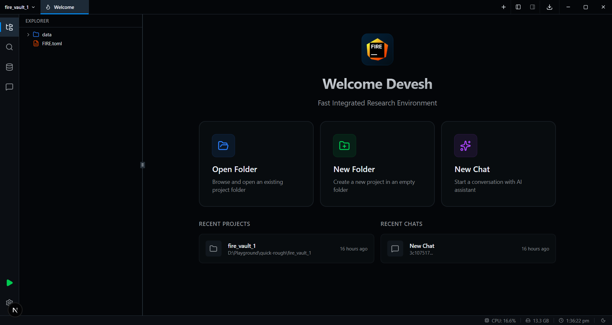

#### Data Ingestion
Load local scientific datasets directly into DuckDB for analysis.

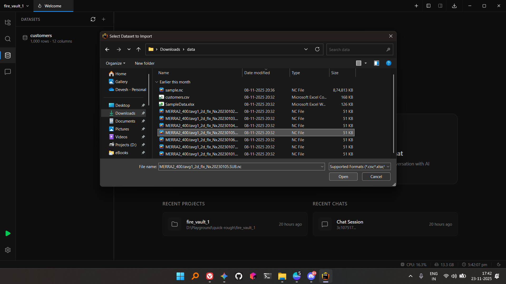

#### Settings Panel
Customize your AI model, API keys, and system preferences.

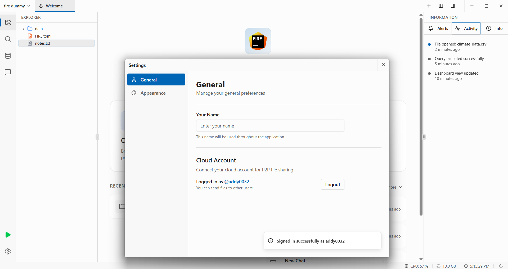

### Authentication Flow

FIRE integrates with AWS Cognito for secure user management.

#### Login
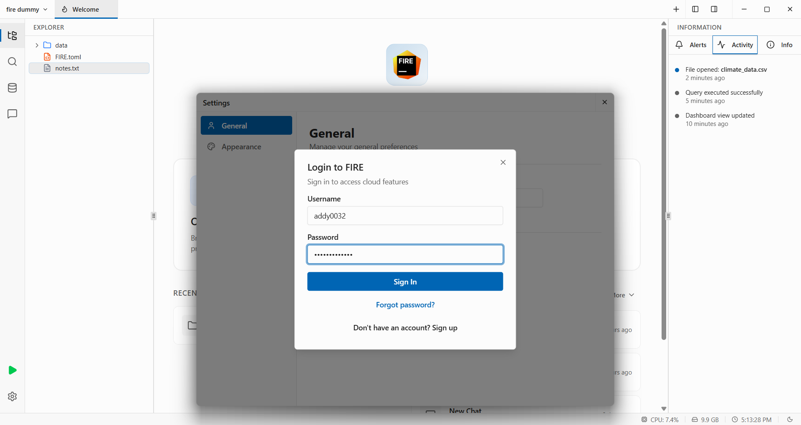

#### Sign Up
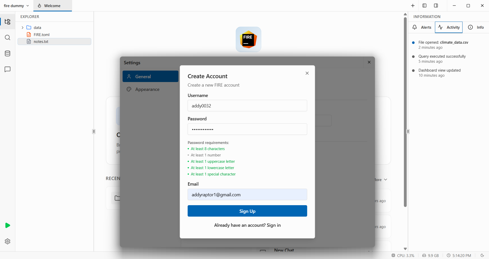

#### AWS Integration
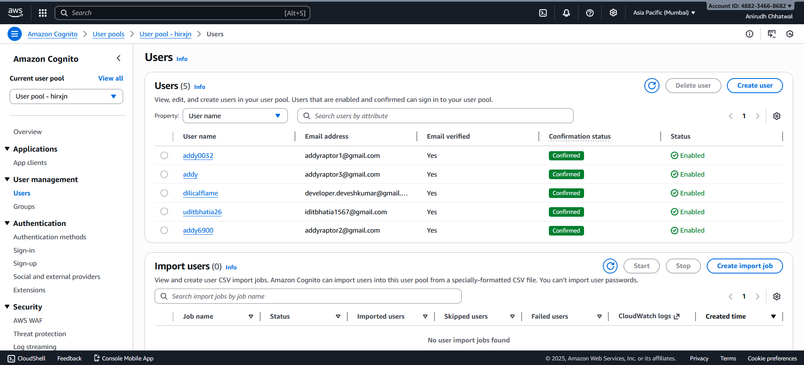
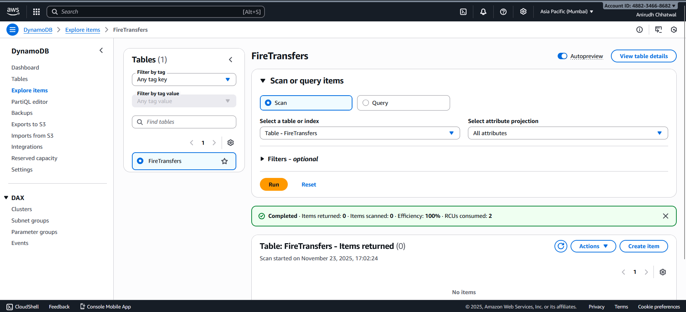

---

## Visualizations

FIRE's AI agent autonomously generates rich, interactive visualizations based on your data queries.

### 3D Globe Visualization
Render geospatial data on an interactive 3D globe with depth filtering and custom overlays.

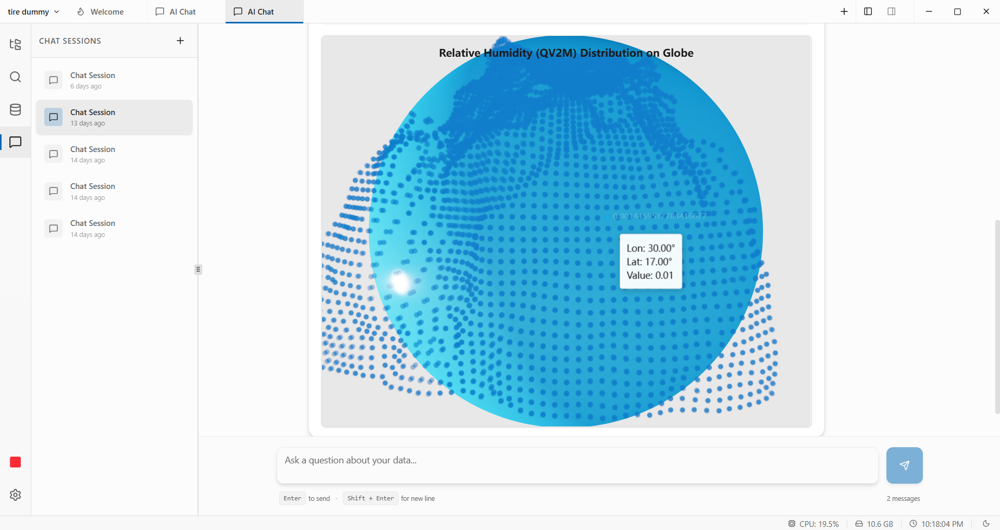

### 3D Scatter Plots
Explore multi-dimensional datasets in 3D space.

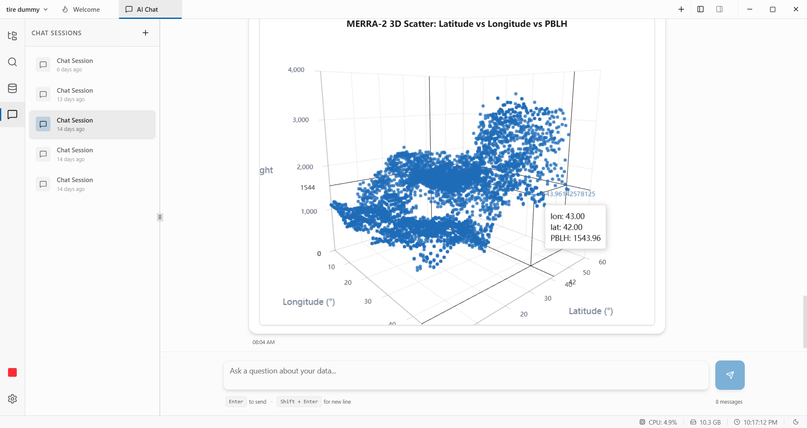

### Statistical Charts

#### Line Plots
Time-series analysis and trend visualization.

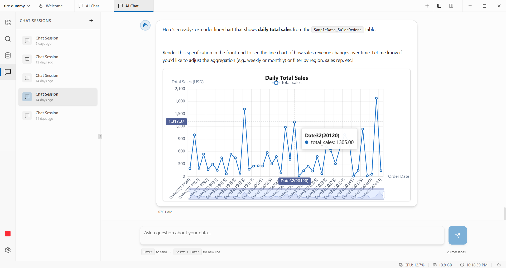

#### Scatter Plots
Correlation analysis and pattern discovery.

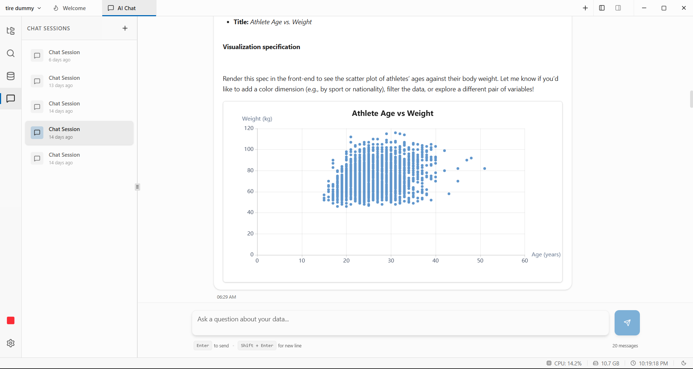

### Competitive Advantage

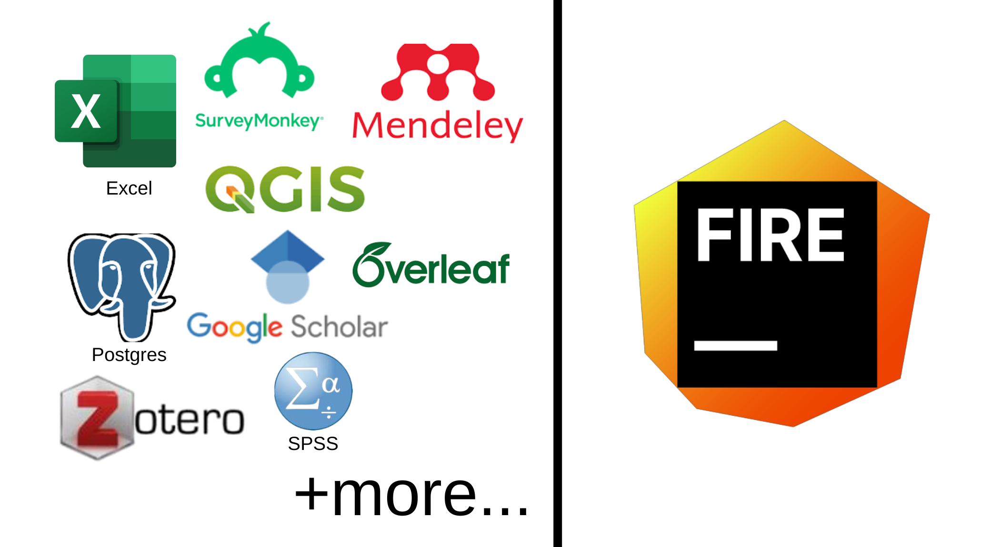

---

## Getting Started for Developers

Prerequisites:
* Node.js (v20+) & pnpm
* Rust (stable)
* Python (v3.11+)
* `uv` (Python package manager fast alternative)

```bash
# 1. Clone the repository
git clone [https://gitlab.com/DilicalFlame/FIRE.git](https://gitlab.com/DilicalFlame/FIRE.git)
cd FIRE

# 2. Install Frontend dependencies
pnpm install

# 3. Setup Python Environment (using uv for speed)
cd src-tauri/python_server
uv venv
source .venv/bin/activate  # On Windows use `.venv\Scripts\activate`
uv pip install -r requirements.txt
# Install Playwright browsers for crawling
python -m playwright install chromium
cd ../..

# 4. Run in development mode (Tauri will build Rust and launch frontend)
pnpm tauri dev